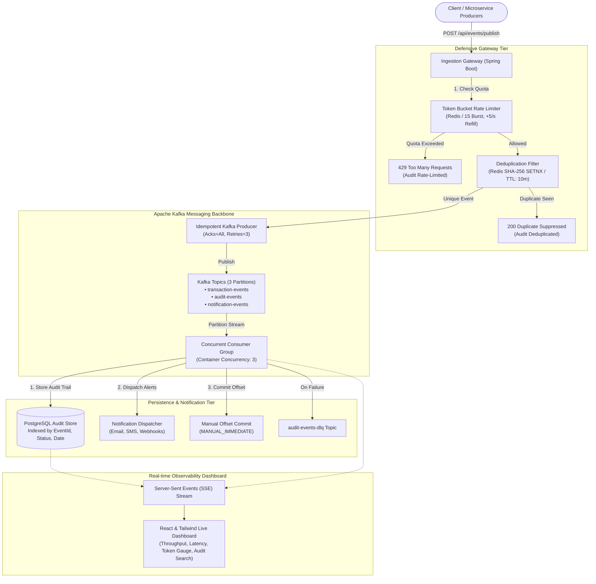

# ⚡ Event-Driven Notification & Audit Pipeline (2024)

> A distributed, high-throughput event processing and audit telemetry microservice built with **Java 21**, **Spring Boot 3.3**, **Apache Kafka**, **Redis**, and **PostgreSQL**, featuring a real-time reactive monitoring dashboard.

[](https://www.oracle.com/java/)
[](https://spring.io/projects/spring-boot)
[](https://kafka.apache.org/)
[](https://redis.io/)
[](https://www.postgresql.org/)
[](https://react.dev/)

---

## 📌 1. Project Overview & Business Problem

In distributed enterprise environments (fintech, insurance, e-commerce), services broadcast thousands of transactional and audit events every second. Without defensive engineering, systems suffer from:
1. **Message Storming & Downstream DB Overload:** Traffic surges can flood downstream relational databases, spiking CPU to 100% and cascading failures.
2. **Duplicate Message Ingestion:** Network retries, consumer rebalances, or client resubmissions cause duplicate ledger updates or redundant notifications.
3. **Data Loss During Consumer Outages:** Auto-committing offsets before committing database transactions risks permanently dropping critical audit events.

### 🛡️ How This Architecture Solves It:
* **Guaranteed At-Least-Once Delivery:** Manual acknowledgment (`AckMode.MANUAL_IMMEDIATE`) commits Kafka consumer offsets *only after* PostgreSQL transaction persistence and downstream notification dispatching succeed.
* **Token Bucket Distributed Rate-Limiting:** Dynamically throttles inbound event spikes at the gateway tier, permitting burst capacity while capping downstream ingress at steady rates.
* **Redis Idempotency & Deduplication:** SHA-256 fingerprinting and 10-minute TTL atomic locks suppress duplicate event processing during traffic bursts with zero database hits.
* **Dead Letter Queue (DLQ):** Poison pills and unparseable events route to `audit-events-dlq` with exponential backoff and isolation.

---

## 🏗️ 2. High-Level System Architecture



---

## ⚙️ 3. Core Technical Implementations

### A. Token Bucket Algorithm (Distributed Rate Limiting)
Located in [`TokenBucketRateLimiter.java`](file:///C:/Users/91986/.gemini/antigravity/scratch/event-pipeline/backend/src/main/java/com/pipeline/limiter/TokenBucketRateLimiter.java):
* **Burst Capacity ($C$):** 15 tokens.
* **Refill Rate ($r$):** 5 tokens per second.
* **Mechanism:**
  $$\text{Tokens}_{\text{new}} = \min(C, \text{Tokens}_{\text{prev}} + (t_{\text{now}} - t_{\text{prev}}) \times r)$$
* If $\text{Tokens}_{\text{new}} \ge 1$, the request is permitted and token count decrements atomically. Otherwise, HTTP 429 (`RATE_LIMITED`) is returned with zero downstream impact.

### B. Redis Idempotency & Deduplication
Located in [`EventDeduplicationService.java`](file:///C:/Users/91986/.gemini/antigravity/scratch/event-pipeline/backend/src/main/java/com/pipeline/dedup/EventDeduplicationService.java):
* Clients can submit an explicit `idempotencyKey` header or parameter.
* If omitted, a SHA-256 fingerprint is generated across the normalized JSON payload:
  $$\text{Key} = \text{SHA-256}(\text{payload})$$
* Atomic Redis `SETNX` (`setIfAbsent`) with a **10-minute TTL** ensures that repeated deliveries of identical events during bursts are acknowledged and suppressed without querying PostgreSQL.

### C. Guaranteed At-Least-Once Delivery
Located in [`EventConsumer.java`](file:///C:/Users/91986/.gemini/antigravity/scratch/event-pipeline/backend/src/main/java/com/pipeline/kafka/EventConsumer.java):
* Auto-commit is explicitly disabled (`enable.auto.commit = false`).
* `ContainerProperties.AckMode.MANUAL_IMMEDIATE` enforces that offsets are only committed to the `__consumer_offsets` topic *after*:
  1. The event is persisted to PostgreSQL via `auditRepository.save()`.
  2. Downstream notification handlers are triggered.

---

## 🚀 4. How to Run the Project

### Option A: Instant Local Run (Zero External Prerequisites)
The application comes pre-configured with **embedded H2 database** and **in-memory resilience fallbacks**, allowing it to start on any machine immediately:

```bash
cd backend
mvn spring-boot:run
```
* **Dashboard & Live Stream UI:** Open `http://localhost:8080`
* **H2 Database Console:** `http://localhost:8080/h2-console` (`JDBC URL: jdbc:h2:mem:auditdb`, `User: sa`, `Password: [empty]`)
* **Health API:** `http://localhost:8080/api/events/health`

---

### Option B: Full Production Environment with Docker Compose
To launch the complete distributed stack (Kafka, Zookeeper, Redis, PostgreSQL, and Spring Boot):

```bash
docker compose up -d
```

| Service | Port | Description |
| :--- | :--- | :--- |
| **Spring Boot Application** | `8080` | Main REST API & Dashboard UI |
| **Apache Kafka Broker** | `9092` | Event broker with 3 partitions |
| **Zookeeper** | `2181` | Cluster metadata coordinator |
| **Redis** | `6379` | Token bucket & deduplication cache |
| **PostgreSQL** | `5432` | Audit log database (`auditdb`) |

---

### Option C: Standalone React Dev Server
If you want to run the React frontend with hot-reload during UI development:

```bash
cd frontend
npm install
npm run dev
```
* React dev server runs on `http://localhost:5173` (auto-proxies API requests to `:8080`).

---

## 📡 5. API Reference & Verification Examples

### 1. Ingest an Event
```bash
curl -X POST http://localhost:8080/api/events/publish \
  -H "Content-Type: application/json" \
  -d '{
    "eventType": "TRANSACTION_SETTLED",
    "sourceService": "payment-gateway",
    "idempotencyKey": "order-txn-10029",
    "data": {
      "amount": 4500.00,
      "currency": "INR",
      "userId": "usr_78821"
    }
  }'
```

### 2. Simulate High-Frequency Traffic Burst (Proves Rate Limiting & Dedup)
```bash
curl -X POST "http://localhost:8080/api/events/burst?count=35&includeDuplicates=true"
```
**Response Preview:**
```json
{
  "burstSize": 35,
  "processed": 15,
  "rateLimitedByTokenBucket": 7,
  "duplicatesBlockedByRedis": 3,
  "sampleResponses": [...]
}
```

### 3. Query Paginated Audit Logs
```bash
curl "http://localhost:8080/api/events/audit?page=0&size=10&status=PROCESSED"
```

### 4. Fetch Live Telemetry Statistics
```bash
curl http://localhost:8080/api/events/stats
```

---

## 🎯 6. Key Resume & Interview Talking Points

When interviewers ask about this project, you can confidently explain:
1. **Why Kafka over RabbitMQ or simple queues?**
   * *Answer:* Kafka's partitioned log architecture allows horizontal scale and ordered partition streams. We can have 3 concurrent consumer threads matching 3 partitions while preserving per-entity order using correlation IDs as partition keys.
2. **How does the Token Bucket rate limiter protect the pipeline?**
   * *Answer:* Unlike fixed-window counters that suffer from boundary burst spikes, the Token Bucket algorithm smoothly refills tokens at a steady rate (+5/sec) while allowing controlled bursts up to the 15-token ceiling.
3. **How is deduplication handled without overloading the database?**
   * *Answer:* Checking database tables on every transaction causes disk I/O bottlenecks. We use Redis atomic `SETNX` with a 10-minute TTL. Uniqueness is evaluated in sub-milliseconds in RAM; duplicates are dropped before touching the database.
4. **How did you achieve guaranteed at-least-once delivery?**
   * *Answer:* We disabled Kafka auto-commits and configured manual immediate offset commits (`MANUAL_IMMEDIATE`). The offset is committed only after the event is successfully saved in the PostgreSQL database and notification hooks are dispatched. Any failure triggers consumer retries or sends the message to the Dead Letter Queue (`audit-events-dlq`).
